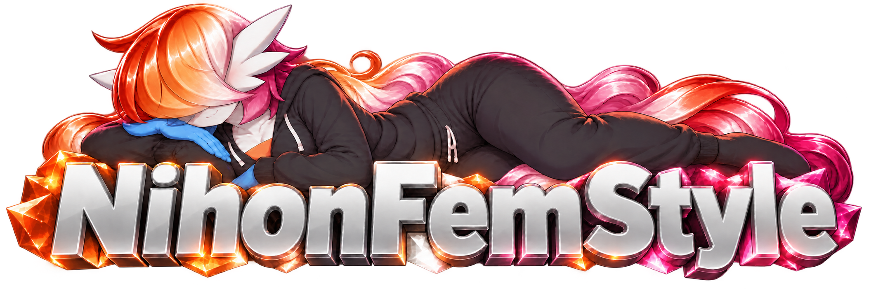
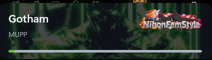
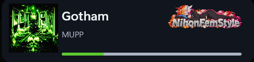
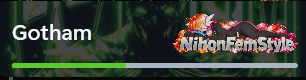
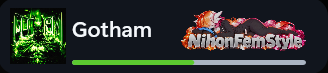
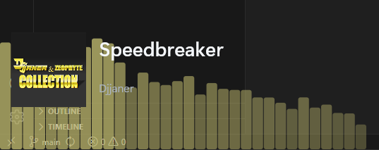
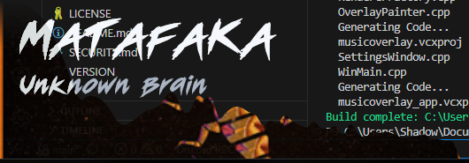

<p align="center"></p>

<h1 align="center">Nihon's Music Framework</h1>

<p align="center">A native, open-source Windows music overlay and reusable DirectX integration library written in modern C++.</p>

<p align="center">
  <a href="https://github.com/NihonFemStyle/music-framework/actions/workflows/build.yml"></a>
  <a href="https://github.com/NihonFemStyle/music-framework/actions/workflows/cutting-edge.yml"></a>
  <a href="https://github.com/NihonFemStyle/music-framework/releases"></a>
  
  
  
  <a href="https://www.jetbrains.com/clion/"></a>
  
</p>

Nihon's Music Framework reads the active Windows media session, renders a native always-on-top overlay, and remains click-through until interaction mode is toggled. It has no third-party GUI framework and is designed both as a standalone application and as a foundation for in-process DirectX integrations.

## Highlights

- Windows media discovery through Global System Media Transport Controls and C++/WinRT
- Title, artist, album, playback state, timeline, and album artwork
- Metadata cleanup that moves featured performers to the artist line and places version/remix suffixes on a new title line
- Smooth, extrapolated progress between Windows media updates
- Always-on-top, click-through Win32 overlay
- Configurable double-tap shortcut for entering and leaving interaction mode
- Native icon controls for previous, play/pause, next, shuffle, and repeat while interactive
- Draggable overlay while interactive
- Compact layout, Windowed Stream Mode, 10–100% opacity, native color picker, and dynamic artwork-derived accent
- Dedicated native settings window plus complete notification-area configuration
- Installed system-font selection with automatic title and artist fitting
- Artwork tile or rounded, aspect-correct background mode
- Region-aware complementary text rendering over artwork, spectra, and Chroma
- DWM backdrop blur where supported
- Native Direct2D, DirectWrite, and WIC rendering
- Tray icon for settings, interaction control, and clean exit
- Optional corner-locked Overkill layout with a source-isolated, real-time audio spectrum
- Persistent settings under `%LOCALAPPDATA%\NihonsMusicFramework\settings.ini`
- Optional Discord Rich Presence with music metadata, playback timestamps, configurable assets, and project links
- Embedded banner, application icon, and Release runtime dependencies
- Renderer abstraction for Direct3D 9, 10, 11, and 12 integration
- Optional SDL3 frontend with full feature parity, presenting through any SDL renderer (OpenGL, Vulkan, Direct3D 11/12, SDL GPU, software)
- No-CRT build of the complete overlay and integration library (no VCRUNTIME, MSVCP, or UCRT imports)

## Preview

<table>
  <tr>
    <td align="center"><strong>Normal — artwork background</strong><br></td>
    <td align="center"><strong>Normal — artwork tile</strong><br></td>
  </tr>
  <tr>
    <td align="center"><strong>Compact — artwork background</strong><br></td>
    <td align="center"><strong>Compact — artwork tile</strong><br></td>
  </tr>
  <tr>
    <td colspan="2" align="center"><strong>Overkill — source-responsive spectrum</strong><br></td>
  </tr>
  <tr>
    <td colspan="2" align="center"><strong>Overkill — custom font and artwork spectrum</strong><br></td>
  </tr>
</table>

## Requirements

- Windows 10 or Windows 11
- Overkill spectrum capture requires Windows 10 build 20348 or newer
- Visual Studio 2022 with **Desktop development with C++**
- Windows 10/11 SDK
- CMake 3.24 or newer
- A media application that publishes a Windows system media session

## Quick start

Clone the repository:

```powershell
git clone https://github.com/NihonFemStyle/music-framework.git
cd music-framework
```

From PowerShell in the repository root:

```powershell
.\build.ps1
```

Run:

```powershell
.\build-x64-default\Release\musicoverlay_app.exe
```

The first launch asks for a renderer preference. The current standalone host renders through Direct3D 11; the saved preference is groundwork for additional standalone hosts and does not yet switch the active standalone API.

## Using the overlay

The overlay starts in click-through mode. Double-tap the configured shortcut within 450 milliseconds to enter or leave interaction mode. The default shortcut is **Shift**.

While interactive:

- Drag unused space to reposition the standard and compact overlays.
- Use the icon-only previous, play/pause, next, shuffle, and repeat controls. Controls unavailable for the current media session remain visible but muted.
- Open the dedicated settings window from the tray icon; the player carries no settings button.
- Choose opacity, compact layout, a custom accent, dynamic accent, artwork-background mode, Overkill mode, installed text font, banner visibility, and parenthetical-title handling.
- Select the shortcut row, press any valid keyboard combination, then release it to save.
- Use the renderer row to save a preferred API for a future restart.

Windowed Stream Mode turns the overlay into a normal interactive window suitable for OBS Window Capture. Its composition surface preserves per-pixel transparency instead of producing a black capture background.

The tray icon provides the complete settings surface directly: transparency presets, compact and Windowed Stream modes, accent and font pickers, artwork mode, shortcut recording, renderer selection, Overkill controls, banner visibility, parenthetical-title handling, interaction mode, Discord Rich Presence, and exit. Options with multiple choices use nested submenus. Double-clicking the tray icon opens the dedicated native settings window.

Text keeps its normal styling where the panel is unobstructed. Portions covered by artwork or spectrum geometry receive a complementary-color pass; Chroma uses the corresponding inverted gradient. This preserves readability without applying a blanket outline or changing unaffected glyph regions.

### Metadata formatting

Common featured-performer markers such as `feat.`, `featuring`, and `ft.` are removed from the title and appended to the artist line. Title separators such as ` - `, en/em dashes, ` | `, and parenthetical suffixes become line breaks so version names, VIP mixes, and remix labels remain readable without forcing the player wider. Parenthetical suffixes can instead be hidden with the persisted **Ignore title parentheses** setting.

### Overkill mode

Overkill mode adds a source-responsive spectrum visualizer around a larger album-art and metadata layout. It can be assigned to any screen corner and is locked there instead of being freely dragged. When the foreground application occupies an entire monitor, the overlay uses that monitor's full bounds rather than its taskbar work area.

The tray settings expose 16–64 bars or curve points, response speed, display delay, maximum height, and a configurable top fade that defaults to 10% and can be disabled with 0%. The spectrum can use the normal accent, an animated Chroma hue shift, or the current artwork as a geometry-clipped transparency mask. Curves flow from the selected corner's screen wall and settle into the top or bottom screen edge rather than ending in a vertical cutoff.

The spectrum uses Windows process-loopback capture for the application that owns the active media session. It deliberately does not fall back to system-wide capture, so unrelated applications are not visualized. Some protected-content players and media applications whose session cannot be mapped to a process may therefore show an idle spectrum.

> On April 1, artwork-background mode intentionally stretches the artwork and the Chroma rate unit develops a suspicious extra `Â`. These are features of questionable artistic merit.

### Discord Rich Presence

Discord Rich Presence can be toggled from the notification-area menu. When enabled, it publishes the current title, artist, album, playback state, and start/end timestamps. Discord uses those timestamps for its native elapsed or remaining-time display. The activity includes **Trigon.Systems** and **GitHub Repo** buttons.

The bundled configuration uses application ID `1061319148602392616` and the `logo` image asset when nothing is playing. See [Discord Rich Presence configuration](docs/DISCORD_RPC.md) to use your own Discord application and artwork asset.

## Build options

```powershell
.\build.ps1 -Configuration Debug
.\build.ps1 -Configuration RelWithDebInfo
.\build.ps1 -Architecture ARM64
.\build.ps1 -Clean
.\build.ps1 -NoCRT
.\build.ps1 -CLion
.\build.ps1 -CLion -SDL
.\build.ps1 -CLion -CLionToolchain MinGW
```

The normal script path remains the default and does not require CLion. Current CLion releases automatically discover the committed CMake presets; `-CLion` configures and builds the matching preset from PowerShell. MSBuild is the default CLion toolchain, with optional MinGW profiles for standard and SDL builds; MinGW architecture follows the configured CLion toolchain. Release builds made with MSVC use the static runtime and embed the application artwork. See [Building](docs/BUILDING.md) for CLion profiles, direct CMake commands, install targets, and troubleshooting.

### Cutting-edge artifacts

Pushes to `main` build downloadable cutting-edge artifacts only when files under `src/` or `include/` change. A manual dispatch can still force a build. The workflow covers x64, Win32, and ARM64 across Debug, Release, RelWithDebInfo, and MinSizeRel, including the experimental no-CRT mode. Artifacts are retained for 14 days and identify their exact commit and configuration in `build-info.txt`; they are development snapshots, not stable releases.

## Renderer support

| Backend | Integration object | Included UI rendering | Standalone host | Notes |
|---|---:|---:|---:|---|
| Direct3D 9 | Yes | Full painter (texture upload) | **Yes** | 9Ex host; transparent via the DWM-extended layered window. |
| Direct3D 10 | Yes | Direct2D/DirectWrite/WIC | **Yes** | 10.1 device with a DirectComposition swap chain. |
| Direct3D 11 | Yes | Direct2D/DirectWrite/WIC | **Yes** | Default and reference backend. |
| Direct3D 12 | Yes | Direct2D via D3D11On12 | **Yes** | Documented queue-ordering and resource-state contract. |
| OpenGL | SDL3 renderer | Shared painter, SDL presentation | Optional | Default SDL renderer; most reliable transparency. |
| Vulkan | SDL3 renderer | Shared painter, SDL presentation | Optional | Also available: Direct3D 11/12, SDL GPU, software. |

The standalone renderer setting chooses the host; it falls back to Direct3D 11 if the chosen backend cannot start. The D3D12 renderer never records into the host's command lists: it submits through D3D11On12 on the host's queue. See [Integration](docs/INTEGRATION.md).

### SDL3 frontend

The optional `musicoverlay_sdl` application matches the native application feature for feature and shares its settings file. Build it with `.\build.ps1 -SDL`, then choose a renderer from the tray menu or pass `--renderer opengl|vulkan|direct3d11|direct3d12|gpu|software|auto`. It is excluded from no-CRT builds because SDL3 needs the CRT.

Linux is a planned future feature. The intended Linux platform layer will use MPRIS for media sessions and PipeWire for audio capture, with compositor-dependent X11/Wayland overlay behavior. macOS is not supported.

## Repository layout

```text
include/MusicOverlay/       Public integration headers
src/Core/                   Thread-safe media state
src/Platform/Windows/       GSMTC and Windows platform code
src/Renderer/               D3D9–D3D12 renderer implementations
src/UI/                     Direct2D/DirectWrite/WIC overlay painter
src/Standalone/             Win32 application, resources, and manifest
src/NoCRT/                  No-CRT runtime support and entry point
assets/                     Embedded banner and application icon sources
docs/                       Design, build, integration, and no-CRT guides
```

## Documentation

- [Building and packaging](docs/BUILDING.md)
- [Architecture](docs/ARCHITECTURE.md)
- [Discord Rich Presence configuration](docs/DISCORD_RPC.md)
- [Integration guide](docs/INTEGRATION.md)
- [No-CRT scope and limitations](docs/NOCRT.md)
- [Publishing releases](docs/RELEASING.md)
- [Changelog](CHANGELOG.md)
- [Contributing](CONTRIBUTING.md)
- [Security policy](SECURITY.md)

## Known limitations

- Windowed Stream Mode transparency for capture tools requires the Direct3D 10, 11, or 12 hosts. The Direct3D 9 host shows the panel on an opaque background in that mode.
- Media availability and metadata quality depend on the source application's GSMTC implementation.
- Source-isolated spectrum capture is best effort and may be unavailable for protected audio or media sessions that Windows cannot map back to a process.
- The no-CRT build covers the full overlay; the SDL frontend is the only component that requires the CRT.

## License

Nihon's Music Framework is available under the [MIT License](LICENSE). You may use, copy, modify, merge, publish, distribute, sublicense, and sell copies subject to the license notice and warranty disclaimer.

